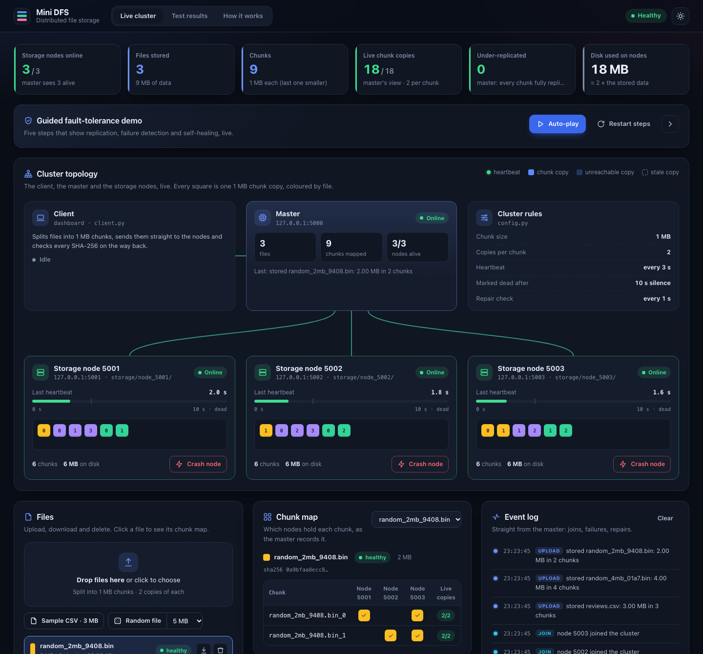

# Mini Distributed File Storage – Project

Distributed Systems group project: a small HDFS-style file storage system in
Python and Flask. Files are split into 1 MB chunks, every chunk is stored on 2 of
3 storage nodes, and files still download complete and unchanged when a node
crashes. The master detects the dead node within about 10 s and re-creates the
lost copies on a healthy node.



## What is in this folder

| Folder | Contents |
|---|---|
| `code/` | The full project: master, storage nodes, client, cluster launcher, web dashboard, automated tests, charts, sample file and its own README |
| `docs/` | Screenshot used in this README |
| `report/` | The written project report as Word (`Project_Report.docx`) and PDF (`Project_Report.pdf`) |
| `presentation/` | The 10 presentation slides with speaker notes as PowerPoint (`Presentation.pptx`) and PDF (`Presentation.pdf`) |

## Run it in three steps

The project uses [uv](https://docs.astral.sh/uv/) to manage Python and its
packages. Install uv once (`curl -LsSf https://astral.sh/uv/install.sh | sh` on
macOS/Linux, or `brew install uv`), then:

```bash
git clone <your-repo-url> Mini-DFS-Project
cd Mini-DFS-Project/code
uv sync                                       # creates .venv with Python 3.13, Flask, requests, matplotlib
uv run dashboard.py --fresh                   # master + 3 storage nodes + web dashboard
```

Open **<http://127.0.0.1:8080>**. The dashboard shows the cluster live and has a
guided demo: upload a file, crash a node, read the file anyway, watch the master
detect the failure and re-create the lost copies, then bring the node back. It
also has the test results and a "How it works" page. The master's own JSON API is
at <http://127.0.0.1:5000/>.

Prefer the terminal? Run `uv run cluster.py --fresh` instead, then in a second
terminal, from the `code` folder:

```bash
uv run client.py upload samples/reviews.csv
uv run client.py map reviews.csv
uv run client.py download reviews.csv
```

Type `stop 5002` in the cluster terminal to crash a node, then download again.
Run `uv run run_tests.py` to repeat tests T1–T6 and redraw the charts.

## Before you submit

- Add your group members and course name on the presentation's first slide.
- Add your GitHub link on the presentation's last slide.
- Add each member's name in the report's team roles table.
- Run `uv run run_tests.py` on your own laptop and update the timings in the report and slides; your numbers will differ slightly, and all tests should still pass.
